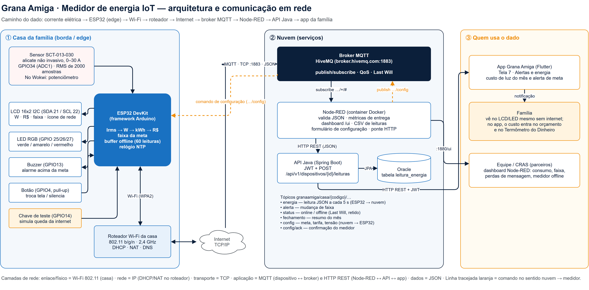
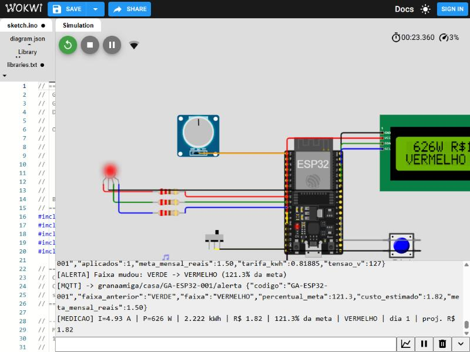
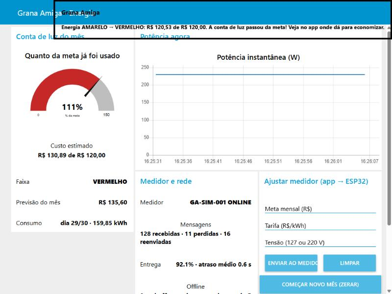

# ⚡ Grana Amiga — Medidor de energia IoT

Global Solution 2026/2 · **CitizenTech** · FIAP — Análise e Desenvolvimento de Sistemas (2º ano)
Disciplina: **Disruptive Architectures: IoT, IoB & Generative IA**

> Um medidor de baixo custo (ESP32 + sensor de corrente) que mostra **em reais** quanto a casa está gastando de luz e **avisa antes de a conta estourar** a meta da família. Ele faz parte do **Grana Amiga**, app de educação e organização financeira para famílias endividadas.

🔗 **Simulação no Wokwi:** https://wokwi.com/projects/480528483029211137
🎥 **Demonstração em vídeo (opcional):** `COLOCAR_LINK_AQUI`

---

## 👥 Integrantes

| Integrante | RM |
| --- | --- |
| Cassio Alexandre Ribeiro de Moraes | 567295 |
| Davi Isac Colin Pereira | 567265 |
| Hugo Souza de Jesus | 568542 |
| Matheus Peres Moraes de Jesus | 567300 |
| Pedro Gonçalves Rodrigues | 567651 |

---

## 1. Problema e proposta CitizenTech

Em julho de 2026, **82% das famílias brasileiras tinham dívidas**, recorde da série da CNC. Entre quem ganha até 3 salários mínimos, o número chega a **84,9%** ([Peic/CNC](https://soubrasilia.com/endividamento-familias-82-por-cento-julho-2026-peic-cnc-recorde/)).

A conta de luz é uma das despesas fixas que mais pesam no orçamento dessas famílias e tem um problema: **o consumo é invisível**. A família só descobre quanto gastou quando a conta chega, e aí já não dá para reagir.

**A proposta:** um medidor instalado no quadro de energia, sem mexer na fiação, que:

1. Mede a corrente da casa e calcula **potência (W), energia (kWh) e custo (R$)** em tempo real;
2. Compara o custo do mês com a **meta definida pela família** e mostra a situação como um **termômetro**: 🟢 verde (< 70% da meta), 🟡 amarelo (70% a 100%), 🔴 vermelho (> 100%, com alarme sonoro);
3. **Prevê** o valor do fim do mês e avisa quando, no ritmo atual, a conta vai passar da meta;
4. **Funciona sem internet** (LCD, LED e buzzer) e, quando há rede, envia os dados para o app e para o painel dos parceiros (CRAS, ONGs).

| Cidadão beneficiado | Famílias de baixa renda (até 3 salários mínimos), inclusive quem tem pouca familiaridade com tecnologia: o termômetro de cores e o alarme dispensam leitura |
| --- | --- |
| Ecossistema | Família · app Grana Amiga · CRAS/prefeituras · distribuidoras e programas de eficiência energética (que distribuiriam o medidor) |
| ODS | **10** (redução das desigualdades), **4** (educação financeira prática) e **13** (menos desperdício de energia) |
| Como medir o impacto | Redução média do consumo nas casas com medidor; % de meses fechados dentro da meta; famílias que saem da faixa vermelha do Termômetro do Dinheiro |

---

## 2. Arquitetura e comunicação em rede



> Fonte editável: [`docs/arquitetura.drawio`](docs/arquitetura.drawio) (abrir no draw.io / diagrams.net).

### 2.1 Caminho percorrido pelo dado

```
Corrente elétrica do quadro
  → SCT-013 (alicate)                    sinal analógico
  → ESP32 (ADC1, GPIO34)                 cálculo na borda: Irms → W → kWh → R$ → faixa
      ├─ LCD / LED RGB / buzzer           resposta local, mesmo sem internet
      └─ Wi-Fi 802.11 b/g/n 2,4 GHz
  → Roteador da casa                     DHCP, NAT, DNS
  → Internet (TCP/IP)
  → Broker MQTT (HiveMQ, porta 1883)     publish/subscribe, tópicos por casa
  → Node-RED (container Docker)          valida, mede entrega, dashboard, CSV, ponte HTTP
  → API Java Spring Boot (VM Azure)      POST /api/leituras → PostgreSQL (leitura_energia)
  → App Grana Amiga (Flutter)            REST + JWT: custo de luz e alerta de meta
```

E no sentido contrário: o dashboard (ou o app) publica em `…/config` e o ESP32 ajusta **meta, tarifa e tensão** sem regravar o firmware.

### 2.2 Dispositivos, meios e componentes de rede

| Trecho | Dispositivo / componente | Meio e protocolo | Por quê |
| --- | --- | --- | --- |
| Sensor → ESP32 | SCT-013-030 | Fio, sinal analógico (ADC 12 bits) | Não invasivo: abraça o fio sem cortar |
| ESP32 → LCD | LCD 16x2 + módulo PCF8574 | Barramento **I2C** (SDA 21 / SCL 22) | Só 2 fios para o display inteiro |
| ESP32 → roteador | Wi-Fi embutido do ESP32 | **Wi-Fi 802.11 b/g/n 2,4 GHz** (WPA2) | Já existe na maioria das casas; sem custo de chip |
| Roteador → Internet | Roteador doméstico | Ethernet/fibra/4G do provedor; **IP com NAT e DHCP** | O medidor recebe IP privado e sai pela internet da casa |
| ESP32 ↔ broker | HiveMQ (público na demo) | **MQTT 3.1.1 sobre TCP, porta 1883**, mensagens JSON | Protocolo leve (cabeçalho de 2 bytes), feito para redes instáveis; publish/subscribe desacopla quem envia de quem recebe |
| Broker → Node-RED | Node-RED em Docker | MQTT (assinatura `granaamiga/casa/+/#`) | Um fluxo atende várias casas pelo curinga `+` |
| Node-RED → API | API Java (VM Azure, entrega DevOps) | **HTTP REST (JSON)** | A API já é o ponto central de dados do app |
| API → app | App Flutter | HTTP REST + **JWT** | Mesmo canal autenticado do resto do app |

**Camadas:** enlace/físico = Wi-Fi · rede = IP · transporte = TCP · aplicação = MQTT e HTTP · dados = JSON.

### 2.3 Tópicos MQTT

| Tópico (`granaamiga/casa/GA-ESP32-001/…`) | Sentido | Conteúdo | Retido |
| --- | --- | --- | --- |
| `energia` | ESP32 → nuvem, a cada 5 s | Leitura completa (exemplo abaixo) | não |
| `alerta` | ESP32 → nuvem | Mudança de faixa: `{"faixa_anterior":"VERDE","faixa":"AMARELO",…}` | não |
| `status` | ESP32 / broker | `online` ao conectar; **`offline` publicado pelo broker (Last Will)** se o medidor cair | sim |
| `fechamento` | ESP32 → nuvem | Resumo do ciclo de 30 dias | não |
| `config` | nuvem → ESP32 | `{"meta_mensal_reais":150}`, `{"tarifa_kwh":0.85}`, `{"tensao_v":220}`, `{"comando":"zerar_mes"}` | não |
| `config/ack` | ESP32 → nuvem | Confirmação com os valores aplicados e os rejeitados | não |

Exemplo real de `energia` (capturado no Wokwi):

```json
{"codigo":"GA-ESP32-001","seq":4,"dt_leitura":"2026-11-12T16:17:40-03:00","irms_a":4.93,"tensao_v":127,
 "potencia_w":625.5,"kwh":3.473,"custo_estimado":2.84,"tarifa_kwh":0.81885,"meta_mensal_reais":1.50,
 "percentual_meta":189.6,"faixa":"VERMELHO","projecao_mes":2.84,"alerta_projecao":false,"dia_ciclo":1,
 "buffer_pendente":0,"descartadas":0,"reenvio":false,"origem":"IOT"}
```

Os nomes dos campos são os mesmos das tabelas `dispositivo` e `leitura_energia` do modelo de dados do grupo, e `origem: "IOT"` é o mesmo valor usado em `transacao.origem`.

---

## 3. Protótipo



### 3.1 Componentes e ligações

| Componente | Pino do ESP32 | Função |
| --- | --- | --- |
| Sensor SCT-013-030 (no Wokwi: **potenciômetro**) | GPIO34 (ADC1) | Corrente da casa |
| LCD 16x2 I2C (0x27) | SDA 21 · SCL 22 · 5V · GND | Potência, custo, faixa, previsão e ícone de rede (caracteres personalizados) |
| LED RGB catodo comum + 3 resistores de 220 Ω | GPIO 25 (R) · 26 (G) · 27 (B) | Termômetro de energia: verde, amarelo (R+G), vermelho |
| Buzzer | GPIO13 | Bipe curto ao entrar no amarelo; alarme a cada 3 s no vermelho |
| Botão (`INPUT_PULLUP`) | GPIO4 | Troca a tela do LCD; com alarme tocando, silencia |
| Chave deslizante (`INPUT_PULLUP`) | GPIO14 | **Teste**: simula queda da internet |

### 3.2 Lógica do firmware ([`medidor_energia/medidor_energia.ino`](medidor_energia/medidor_energia.ino))

```
Irms (RMS de 2000 amostras)  × tensão (127 V)        = potência (W)
potência × tempo                                      = kWh acumulado no mês
kWh × (tarifa R$ 0,80 + bandeira R$ 0,01885)          = custo estimado (R$)
custo ÷ meta → < 70% VERDE · 70–100% AMARELO · > 100% VERMELHO + buzzer
custo ÷ horas decorridas × 720 h                      = previsão do fim do mês
```

- **Sem `delay()` no loop:** cada tarefa (medir 1 s, publicar 5 s, LCD 0,5 s, reconectar 5 s) roda pelo `millis()`, então o medidor nunca trava esperando a rede.
- **Modo simulação** (`#define MODO_SIMULACAO 1`): o potenciômetro representa 0 a 10 A e o tempo é acelerado (**1 s real = 1 h de consumo**; o mês inteiro passa em 12 minutos). Com `0`, usa o SCT-013 em tempo real.
- **Buffer offline:** fila circular de 60 leituras; sem conexão, as leituras ficam guardadas e são reenviadas na ordem com `"reenvio": true`.
- **Número de sequência (`seq`):** permite ao Node-RED detectar mensagens perdidas.
- **Relógio NTP:** cada leitura leva a hora real (`dt_leitura`), inclusive as reenviadas.

### 3.3 Telas do LCD (botão alterna)

| Tela | Linha 1 | Linha 2 |
| --- | --- | --- |
| 0 | `626W R$2,84` | `VERMELHO 189%` + ícone de rede |
| 1 | `Mes 3,47 kWh` | `Prev R$135,60!` (o `!` indica que vai estourar) |
| 2 | `Meta R$120,00` | `Dia 3 de 30` |
| 3 | `MQTT ON  Buf 0` | IP do medidor ou `Sem internet` |

---

## 4. Como executar

### 4.1 Simulação no Wokwi (recomendado para avaliação)

**Opção A:** abrir <https://wokwi.com/projects/480528483029211137> e clicar em ▶ (não precisa de conta para rodar).

**Opção B:** montar do zero:
1. Acesse <https://wokwi.com/projects/new/esp32>.
2. Na aba `sketch.ino`, cole o conteúdo de [`medidor_energia/medidor_energia.ino`](medidor_energia/medidor_energia.ino).
3. Na aba `diagram.json`, cole o conteúdo de [`medidor_energia/diagram.json`](medidor_energia/diagram.json).
4. Em **Library Manager**, adicione `PubSubClient`, `ArduinoJson` e `LiquidCrystal I2C` (lista em [`libraries.txt`](medidor_energia/libraries.txt)).
5. Clique em ▶. Gire o potenciômetro para mudar o consumo e acompanhe o Serial Monitor.

> 💡 Mantenha a aba do Wokwi **em primeiro plano**: em segundo plano o navegador desacelera a simulação.

### 4.2 Node-RED (dashboard e integração)

Pré-requisito: Docker.

```bash
cd node-red
cp .env.example .env    # opcional: muda broker, código do medidor ou URL da API
docker compose up -d --build
```

- Dashboard: <http://localhost:1880/ui> · Editor: <http://localhost:1880>
- Com o Wokwi rodando, as leituras aparecem no dashboard em segundos.
- O formulário **"Ajustar medidor"** envia meta/tarifa/tensão para o ESP32 pelo tópico `…/config`.

### 4.3 Testar sem o Wokwi (simulador)

```bash
pip install -r tools/requirements.txt
python tools/simulador_medidor.py --potencia 230 --perder-a-cada 10 --offline 40-55
```

Publica um mês inteiro em ~1 minuto, com perda e queda de conexão induzidas (ver [`docs/testes.md`](docs/testes.md)).

### 4.4 Ver o tráfego MQTT diretamente

```bash
docker run --rm eclipse-mosquitto:2.0.20 mosquitto_sub -h broker.hivemq.com -t 'granaamiga/casa/#' -v
```

Para enviar um comando ao medidor:

```bash
docker run --rm eclipse-mosquitto:2.0.20 mosquitto_pub -h broker.hivemq.com -t granaamiga/casa/GA-ESP32-001/config -m '{"meta_mensal_reais": 150}'
```

### 4.5 Protótipo físico

1. Arduino IDE 2 com a placa **esp32 by Espressif** (Gerenciador de Placas) e as 3 bibliotecas acima.
2. Copie `medidor_energia/secrets.example.h` para `secrets.h` e preencha Wi-Fi e broker (**o `secrets.h` não vai para o Git**).
3. Em `medidor_energia.ino`, troque para `#define MODO_SIMULACAO 0`.
4. Ligação do SCT-013-030: saída do alicate entre o GPIO34 e um ponto médio de **1,65 V** (divisor com 2 resistores de 10 kΩ entre 3V3 e GND + capacitor de 10 µF). Abraçar **apenas um** fio (fase) do quadro.
5. Calibrar comparando com um multímetro alicate e ajustar `SCT_AMPERES_POR_VOLT`.

---

## 5. Justificativas técnicas

| Escolha | Alternativas consideradas | Por que esta |
| --- | --- | --- |
| **ESP32** | Arduino UNO (usado nas aulas) | O UNO não tem rede; o ESP32 usa a **mesma IDE e a mesma estrutura `setup()`/`loop()`**, já tem Wi-Fi e custa ~R$ 40 |
| **SCT-013 (não invasivo)** | ACS712, PZEM-004T | Seguro: não exige cortar a fiação de 127/220 V. O ACS712 precisa ficar **em série** com a rede, o que é perigoso para uma instalação doméstica |
| **Cálculo RMS próprio** | Biblioteca EmonLib | Mesmo algoritmo (média dos quadrados com filtro do nível DC), mas explícito no código e sem dependência extra |
| **GPIO34 (ADC1)** | Qualquer pino analógico | No ESP32, o **ADC2 não funciona com o Wi-Fi ligado** |
| **Cálculo na borda** | Mandar a leitura bruta para a nuvem | O LCD/LED funcionam sem internet e a rede só transporta ~390 bytes a cada 5 s |
| **MQTT** | HTTP direto do ESP32 para a API | Conexão persistente, cabeçalho mínimo, publish/subscribe (vários consumidores), **Last Will** para detectar queda e comando no sentido contrário sem o ESP32 precisar ser servidor |
| **JSON** | Texto livre, binário | Legível por qualquer sistema (Node-RED, Java, Flutter) e com os mesmos nomes do banco |
| **Node-RED** | Código próprio em Java | Indicado pelo professor e já conhecido pelo grupo (usado no ano anterior na disciplina de Inteligência Artificial e Chatbot); visual e rápido para validar, gerar dashboard e fazer ponte MQTT → HTTP; roda em container na mesma VM da API |
| **Buffer + `seq`** | Confiar só no QoS | A PubSubClient só publica com QoS 0; o `seq` mostra perdas e o buffer recupera quedas |
| **Wokwi** | Tinkercad (usado nas aulas) | O Tinkercad não tem ESP32 nem Wi-Fi e a simulação não acessa a internet, então a parte de rede teria de ser fingida. O Wokwi simula o ESP32 com Wi-Fi de verdade: as mensagens chegaram ao broker público e ao Node-RED |

> **Por que não usamos o Tinkercad, a ferramenta das aulas?** A solução depende de comunicação em rede (Wi-Fi + MQTT), e o Tinkercad não oferece placa com Wi-Fi nem acesso à internet a partir da simulação. Antes de seguir, o grupo consultou o professor da disciplina, que aprovou o uso do **Wokwi com ESP32** (conteúdo previsto para o próximo semestre) e indicou a **PubSubClient** para o MQTT e o **Node-RED** para o dashboard, exatamente as ferramentas adotadas. O firmware continua sendo Arduino (C++), com a mesma estrutura `setup()`/`loop()` e as mesmas funções vistas em aula (`analogRead()`, `digitalWrite()`).

---

## 6. Testes e evidências

Resumo (detalhes, critérios, métricas e limitações em **[`docs/testes.md`](docs/testes.md)**):

| Teste | Resultado |
| --- | --- |
| Cálculo de potência e custo no Wokwi | ✅ 4,93 A × 127 V = 626 W; 0,971 kWh × R$ 0,81885 = R$ 0,80 |
| Wi-Fi + MQTT + status `online` (retido) | ✅ |
| Buffer offline e reenvio | ✅ leitura guardada antes da rede subir e reenviada com `reenvio: true` |
| Comando remoto e confirmação | ✅ meta alterada pelo MQTT → `config/ack` → faixa VERMELHO, LED e buzzer |
| Last Will (medidor some) | ✅ broker publicou `offline` sozinho |
| Detecção de perda (10% induzida) | ✅ 132 recebidas, **12 perdidas detectadas**, entrega 91,7% |
| Reenvio após queda | ✅ 16 de 16, na ordem e sem duplicar |
| Boot do ESP32 | ⚠️ travamento encontrado no teste e corrigido (NTP só após o Wi-Fi) |

| Evidência | Arquivo |
| --- | --- |
| Serial do Wokwi | [`docs/evidencias/serial-wokwi.txt`](docs/evidencias/serial-wokwi.txt) e reteste do boot e da chave offline em [`serial-wokwi-reteste.txt`](docs/evidencias/serial-wokwi-reteste.txt) |
| Tráfego MQTT capturado por um assinante independente | [`docs/evidencias/mqtt-log.txt`](docs/evidencias/mqtt-log.txt) e reconexão depois de reinício em [`mqtt-log-reconexao.txt`](docs/evidencias/mqtt-log-reconexao.txt) |
| Leituras gravadas pelo Node-RED | [`docs/evidencias/leituras-node-red.csv`](docs/evidencias/leituras-node-red.csv) |
| Capturas do circuito e do dashboard | [`docs/evidencias/`](docs/evidencias/) |



---

## 7. Tecnologias

| Camada | Tecnologia |
| --- | --- |
| Dispositivo | ESP32 DevKit (framework Arduino), SCT-013-030, LCD 16x2 I2C, LED RGB, buzzer, botão, chave |
| Bibliotecas | PubSubClient 2.8, ArduinoJson 7, LiquidCrystal I2C |
| Simulação | Wokwi (ESP32 + rede `Wokwi-GUEST`) |
| Rede | Wi-Fi 802.11 b/g/n, TCP/IP, MQTT 3.1.1, HTTP REST, NTP |
| Broker | HiveMQ público (demo) · Mosquitto/HiveMQ Cloud com TLS (produção) |
| Integração e painel | Node-RED 4 + node-red-dashboard, em Docker |
| Testes | Simulador Python (paho-mqtt), `mosquitto_sub`/`mosquitto_pub` |
| Diagrama | draw.io |

## 8. Estrutura do repositório

```
README.md
medidor_energia/
├── medidor_energia.ino     firmware (Arduino IDE e Wokwi)
├── diagram.json            circuito do Wokwi
├── libraries.txt           bibliotecas
└── secrets.example.h       modelo de credenciais (o secrets.h real não é versionado)
node-red/
├── flows.json              fluxo: validação, métricas, dashboard, CSV, comandos, ponte HTTP
├── Dockerfile              Node-RED + dashboard + fluxo
├── docker-compose.yml
└── .env.example
tools/
├── simulador_medidor.py    gera leituras com perda/queda induzidas
└── requirements.txt
docs/
├── arquitetura.drawio / .png
├── testes.md               casos de teste, métricas e limitações
└── evidencias/             logs, CSV e capturas
```

## 9. Uso de IA generativa

O grupo usou o **Claude (Anthropic)** como apoio para revisar o firmware, montar o fluxo do Node-RED, gerar o diagrama e organizar a documentação. O código foi executado no Wokwi, no Node-RED (Docker) e no broker MQTT público, e os resultados registrados em `docs/testes.md` vêm dessas execuções. O grupo revisou o conteúdo e responde por todas as decisões técnicas.

---

Projeto acadêmico da Global Solution 2026/2 (FIAP), tema **CitizenTech — Tecnologia com o cidadão no centro da inovação**.
